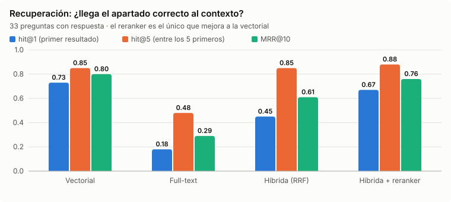
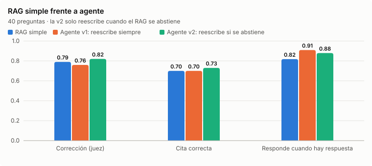
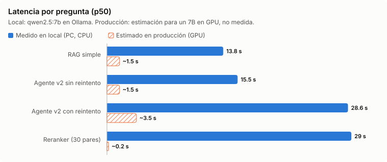
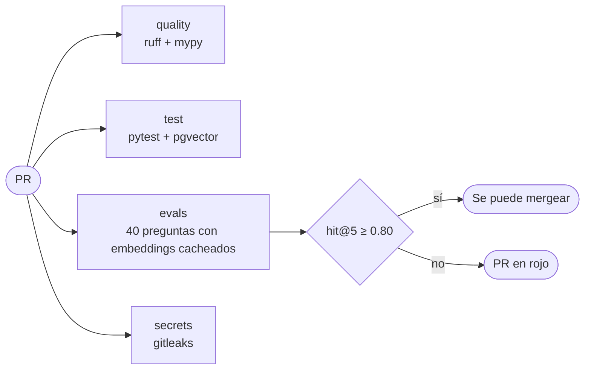
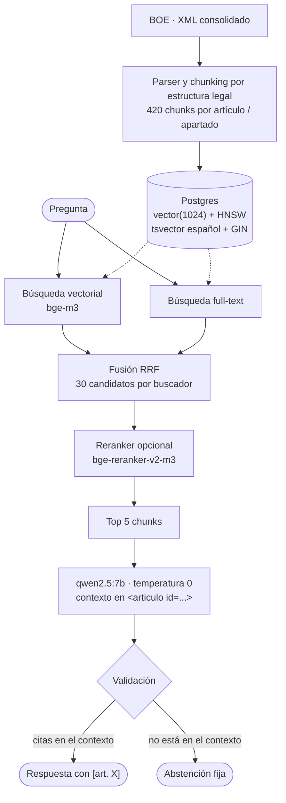
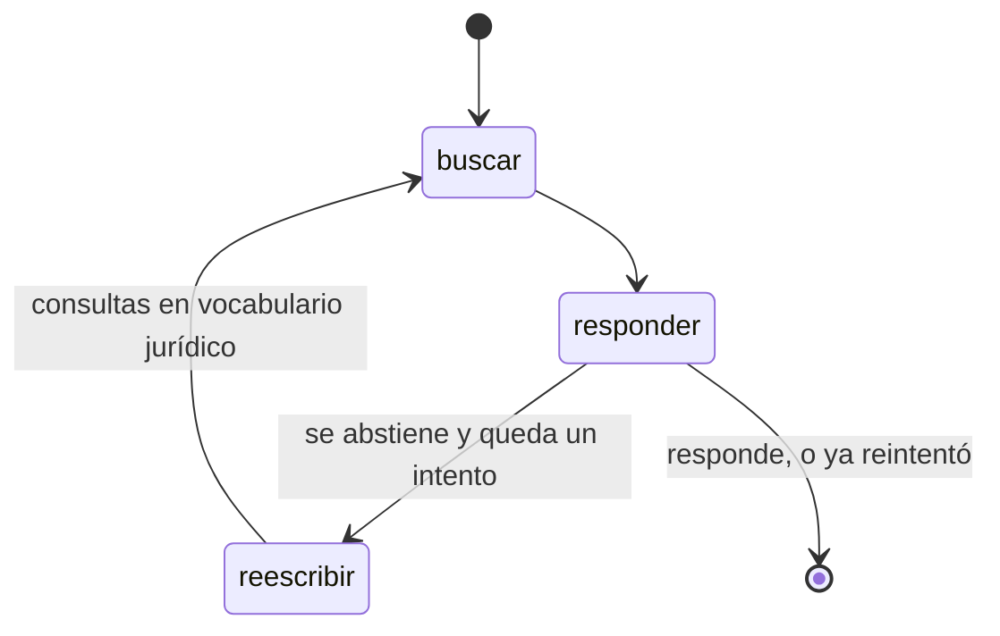

# estatuto-rag

[](https://github.com/MatteoMurcia/estatuto-rag/actions/workflows/ci.yml)


Asistente de preguntas sobre el **Estatuto de los Trabajadores** que responde citando el artículo exacto, se abstiene cuando la ley no lo dice, y **mide su propia calidad en cada PR**.

Todo corre en local y gratis: Postgres + pgvector, embeddings `bge-m3` y generación con `qwen2.5:7b` vía Ollama.

> **Aviso:** no es asesoramiento jurídico. Los convenios colectivos pueden mejorar lo que establece el Estatuto.

## Resultados

Sobre un golden set de **40 preguntas** revisadas a mano contra el BOE: 15 directas, 12 en lenguaje coloquial, 6 que necesitan dos artículos y 7 que el Estatuto no responde.

**Recuperación** (33 preguntas con respuesta; un acierto exige el apartado correcto, no solo el artículo):

| Estrategia | hit@1 | hit@5 | recall@5 | MRR@10 | p50 |
|---|---|---|---|---|---|
| Vectorial (bge-m3) | 0.73 | 0.85 | 0.82 | 0.80 | 48 ms |
| Full-text (Postgres, español) | 0.18 | 0.48 | 0.44 | 0.29 | 3 ms |
| Híbrida (RRF) | 0.45 | 0.85 | 0.80 | 0.61 | 53 ms |
| Híbrida + reranker (bge-reranker-v2-m3) | **0.67** | **0.88** | **0.85** | **0.76** | 29 s (CPU) |



hit@5 en preguntas coloquiales ("me han echado por llegar tarde"): 0.58 vectorial, 0.67 con reranker. En las directas y multi-artículo: 1.00.

**Generación** (RAG simple, búsqueda híbrida, 40 preguntas):

| Métrica | Valor | Cómo se mide |
|---|---|---|
| Abstención correcta | **7/7** | En las preguntas sin respuesta, dice que no lo encuentra |
| Abstención indebida | 6/33 | Se abstiene cuando sí había respuesta |
| Citas inventadas | **0/40** | Cita un artículo que no estaba en el contexto |
| Cita correcta | 0.70 | Cita al menos uno de los artículos de referencia |
| Cifras fieles | 26/27 | Todos los números de la respuesta aparecen en el contexto |
| Corrección | 0.79 | Juez LLM (phi4-mini) contra la respuesta de referencia |

**RAG simple frente a agente** (LangGraph: si el modelo se abstiene, reescribe la pregunta en vocabulario jurídico y vuelve a buscar):

| | RAG simple | Agente v1: reescribe siempre | Agente v2: reescribe solo si se abstiene |
|---|---|---|---|
| Abstención indebida | 6/33 | **3/33** | 4/33 |
| Abstención correcta | 7/7 | 7/7 | 7/7 |
| Corrección (juez) | 0.79 | 0.76 | **0.82** |
| Cita correcta | 0.70 | 0.70 | **0.73** |
| Cifras fieles | 26/27 | 30/30 | 27/29 |
| p50 | **13.8 s** | 38.5 s | 17.0 s |



*"Responde cuando hay respuesta" = 1 − abstención indebida (27/33, 30/33, 29/33).*

Fuente: [`results/`](results/) (el reranker se midió en una ejecución anterior con el mismo código de recuperación). Se regeneran con `python -m estatuto_rag.evals` y `python -m estatuto_rag.evals.generacion`.

## Lo que enseñan los números

1. **La fusión híbrida no mejora al vectorial; el reranker sí.** La búsqueda full-text es débil con preguntas naturales y, al fusionarla, mete ruido en la primera posición (hit@1 0.73 → 0.45). El reranker lo recupera (0.67) y sube el hit@5, pero cuesta 29 s por pregunta sin GPU: en este hardware no compensa (ver [Latencia](#latencia-por-qué-tarda-y-cuánto-tardaría-en-producción)).
2. **El cuello de botella es la recuperación de preguntas coloquiales.** En 4 de las 6 abstenciones indebidas del RAG simple, el artículo que hace falta no llega al contexto. Por eso lo siguiente fue un agente que reescribe la consulta, no un modelo más grande.
3. **Un juez LLM sin validar es ruido.** Con respuestas casi idénticas, el juez de fidelidad pasó de 0.46 a 1.00 y dio por buena una respuesta que se inventaba una jornada de "42 horas". Lo sustituí por una comprobación determinista de cifras, que detecta justo esa alucinación.
4. **La versión del agente que parecía más lista era peor.** Reescribir *todas* las preguntas bajaba el hit@5 de 0.85 a 0.79 (con 3 reescrituras contra 1 original, RRF deja que las reescrituras que se desvían echen el artículo correcto) y casi triplicaba la latencia. La mejora venía del *reintento*. En la v2, el primer intento es el RAG simple y la reescritura es el plan B: las preguntas directas no pueden empeorar y la mayoría no pagan la llamada extra. Ejemplo: "Me han echado por llegar tarde muchas veces, ¿pueden hacerlo?" → el RAG simple se abstiene; el agente reescribe "despido disciplinario por incumplimiento de deberes", encuentra el art. 54 y responde bien.
5. **Responder más también es arriesgarse más.** En m03 el agente deja de abstenerse, pero la reescritura le lleva al despido disciplinario y aplica la indemnización del improcedente a un despido objetivo. Abstenerse era mejor. Las cifras fieles bajan de 26/27 a 27/29 por eso.
6. **Antes de fiarte de una métrica, mira sus fallos.** La primera medición daba un 23 % de citas inventadas; casi todas eran citas *más precisas* que el chunk (`[art. 38.1]` con el artículo 38 entero en el contexto). Era un fallo de la métrica, no del modelo.

## Latencia: por qué tarda y cuánto tardaría en producción

Las latencias de arriba son **en local**: Ollama con qwen2.5:7b en un PC de escritorio, sin servidor de inferencia. La búsqueda no es el problema (53 ms la híbrida); casi todo el tiempo es el LLM.

**Medido** (`results/generacion.json`, 40 preguntas):

| | p50 | p90 |
|---|---|---|
| RAG simple | 13.8 s | 17.5 s |
| Agente v2, sin reintento (27 preguntas) | 15.5 s | |
| Agente v2, con reintento (13 preguntas) | 28.6 s | 42.6 s (todas) |
| Reranker, 30 pares en CPU | 29 s | |

**Por qué.** Cada respuesta lleva unos 7.000 caracteres de contexto (5 chunks, ~2.500 tokens) y genera solo ~130 caracteres (~40 tokens). Con una salida tan corta, la mayor parte del tiempo es *leer* el prompt (prefill), que en CPU o GPU de consumo va a unos cientos de tokens por segundo (inferido de estos tamaños, no perfilado). El agente con reintento hace tres llamadas (responder, reescribir, responder otra vez) y paga ese prefill dos veces. El reranker es un cross-encoder: 30 pasadas completas del modelo por pregunta, a ~1 s cada una en CPU.



**Estimación en producción** (no medida aquí: órdenes de magnitud para un 7B servido con vLLM en una GPU tipo L4/A10, o un modelo equivalente por API):

| Paso | Local | Producción (estimado) |
|---|---|---|
| Embedding de la consulta + búsqueda híbrida | ~50 ms | ~50 ms |
| Reranker (30 pares) | 29 s | 0.1–0.3 s en GPU |
| Prefill (~2.500 tokens) | la mayor parte de los ~14 s (inferido) | 0.2–0.5 s |
| Generación (~40 tokens) | | 0.5–1 s (50–100 tokens/s) |
| **RAG simple** | **13.8 s** | **~1–2 s** |
| **Agente v2 con reintento** | **28.6 s** | **~3–4 s** |

Con streaming, lo que percibe el usuario es el primer token (~0.5 s). Las decisiones que más pesan en producción ya están en el diseño: el agente solo reintenta cuando el RAG se abstiene (dos de cada tres preguntas no pagan el extra), y el reranker solo compensa con GPU. Lo siguiente sería cachear respuestas a preguntas repetidas y, para el reintento, usar un modelo más pequeño para reescribir.

## Calidad en CI

Además de lint, tipos y tests, el job `evals` ejecuta el golden set con los **embeddings bge-m3 precalculados** (versionados en `data/embeddings/`), así que la CI evalúa con el modelo real sin GPU ni APIs de pago. **Si el hit@5 de la búsqueda híbrida baja de 0.80, el PR falla.**



Prueba: el [PR #5](https://github.com/MatteoMurcia/estatuto-rag/pull/5) cambia una línea (100 candidatos por buscador en vez de 30, que parece "más recall"). Los tests unitarios pasan; el gate lo para con hit@5 = 0.79.

La evaluación de generación no va en CI: necesita un LLM y en un runner gratuito tardaría horas. Lo barato y determinista en cada PR; lo caro, en local antes de cambiar el prompt o el modelo.

## Cómo funciona



- **Chunking por estructura legal:** un chunk por artículo si cabe en 400 tokens; si no, por apartado; si un apartado sigue siendo largo, se agrupan párrafos enteros. Cada chunk lleva la ruta jerárquica como cabecera, para que un apartado suelto conserve de qué artículo y capítulo forma parte.
- **Citas verificables:** el modelo solo puede citar ids que estaban en el contexto; las demás se marcan como inventadas en la respuesta de la API.
- **Abstención explícita:** si el contexto no contiene la respuesta, una frase fija y detectable.
- **Agente** ([`agente/grafo.py`](src/estatuto_rag/agente/grafo.py)): `buscar → responder` y, si se abstiene, `reescribir → buscar → responder` una vez más. Mismo prompt y misma validación de citas que el RAG simple, para que la comparación mida solo el reintento.



## Ejecutarlo

Requisitos: Docker, [Ollama](https://ollama.com) y [uv](https://docs.astral.sh/uv/).

```bash
docker compose up -d db
ollama pull bge-m3 && ollama pull qwen2.5:7b
uv sync
uv run python -m estatuto_rag.store                # indexa los 420 chunks (~30 s)
uv run uvicorn estatuto_rag.api:app                # POST /ask
```

```bash
curl -s localhost:8000/ask -H 'Content-Type: application/json' \
  -d '{"pregunta": "¿Cuántos días de vacaciones me corresponden?"}'
```

Demo web (pregunta, modo RAG simple o agente, respuesta con citas, artículos leídos y reescrituras del agente):

```bash
uv sync --extra demo
uv run streamlit run src/estatuto_rag/demo.py         # http://localhost:8501
```

Evaluaciones:

```bash
uv run python -m estatuto_rag.evals                     # recuperación (añade --rerank con `uv sync --extra rerank`)
uv run python -m estatuto_rag.evals.generacion          # generación (necesita también: ollama pull phi4-mini)
uv run python -m estatuto_rag.evals.cache               # regenera los embeddings si cambias chunks o preguntas
bash scripts/verify_ci.sh                               # lo mismo que la CI, en local
```

## Limitaciones

- 40 preguntas son pocas: una pregunta mueve el hit@5 tres puntos. Sirven para detectar regresiones, no para afinar decimales.
- El golden set lo redacté yo; las preguntas reales serán más ambiguas.
- "Cifras fieles" detecta cifras inventadas, no cifras reales aplicadas al caso equivocado (lo cubre, a medias, la corrección).
- Solo el Estatuto: no cubre convenios colectivos, Seguridad Social ni jurisprudencia.

## Próximos pasos

- Usar la puntuación del reranker como señal de abstención antes de generar (si ningún chunk supera un umbral, ni siquiera llamar al LLM).
- Ampliar el golden set con preguntas reales; con 33 preguntas, una sola mueve 3 puntos.

Texto legal: [BOE-A-2015-11430](https://www.boe.es/buscar/act.php?id=BOE-A-2015-11430), versión consolidada descargada el 29/10/2026.

## Licencia

Código bajo licencia [MIT](LICENSE). El texto del Estatuto es del BOE y no está cubierto por esta licencia. Para reportar vulnerabilidades, ver [SECURITY.md](SECURITY.md).
